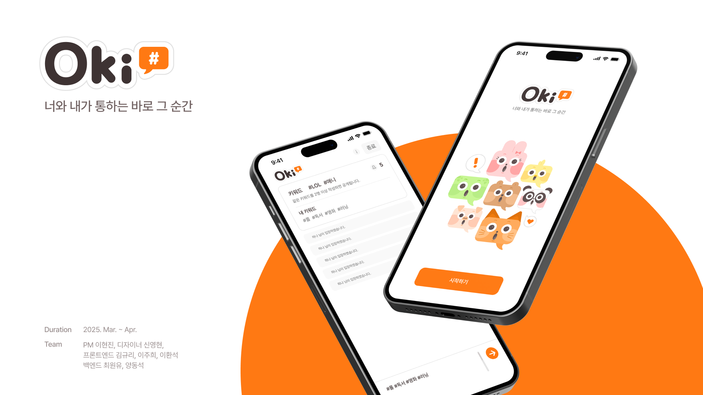
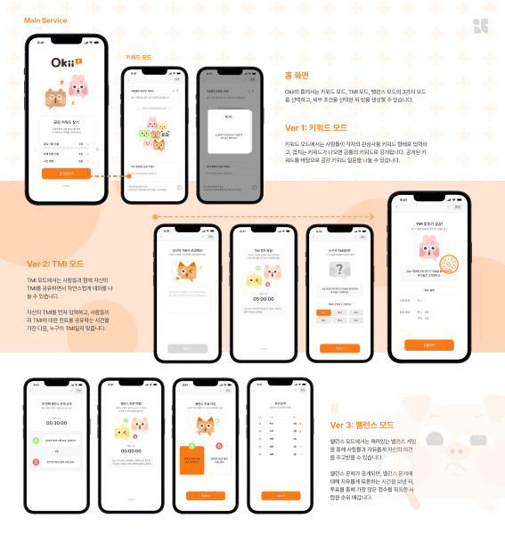

# Okii Frontend



키워드로 공통 관심사를 찾고, TMI 퀴즈와 밸런스 게임으로 대화를 이어가는 아이스브레이킹 웹 서비스입니다. 방을 생성한 뒤 링크 또는 QR 코드로 참여자를 초대하며, 서버가 전달하는 게임 진행 이벤트에 따라 화면을 갱신합니다.

React + TypeScript + Vite를 기반으로 구현했습니다. 아래 내용은 이 저장소의 프런트엔드 구현을 기준으로 정리했으며, 기존 Vite 템플릿 설명은 문서 하단에 보존했습니다.

## 주요 기능

| 모드 | 사용자 흐름 | 프런트엔드의 주요 처리 |
| --- | --- | --- |
| 키워드 (`NORMAL`) | 키워드 입력 → 공통 키워드 공개 → 관련 질문 확인 → 대화 요약 | 키워드 전송, 분석 결과의 공감 인원 필터링, 입·퇴장 및 방 종료 이벤트 반영 |
| TMI (`TMI`) | TMI 입력 → 수집 대기 → 힌트 → 인물 투표 → 라운드 결과 → 최종 요약 | 수집·투표 진행률 표시, 서버가 전달한 남은 시간 표시, 참여자 검색 및 투표 제출 |
| 밸런스 (`BALANCE`) | 참여 대기 → 질문 공개 → 토론 → A/B 투표 → 결과·순위 → 다음 라운드 또는 종료 | 단계별 이벤트에 따른 이동, 선택 비율 시각화, 점수·순위 및 최종 통계 표시 |

공통으로 닉네임·비밀번호를 통한 방 참여, 캐릭터 표시, 초대 링크 복사, QR 코드 저장, 결과 요약 카드의 PNG 저장을 제공합니다.



## 기술 스택

버전은 `package.json`에 선언된 기준입니다.

| 구분 | 기술 | 프로젝트에서의 사용 |
| --- | --- | --- |
| UI | React 19, TypeScript 5.7 | 함수형 컴포넌트, props·상태·일부 API 응답 타입 정의 |
| 개발·빌드 | Vite 6, `@vitejs/plugin-react` | HMR/Fast Refresh, 개발 서버 프록시, 프로덕션 번들 생성 |
| 라우팅 | React Router DOM 7 | `roomKey` 기반 모드별 페이지 구성, 게임 단계에 따른 이동 |
| 상태 관리 | Zustand 5 | 참여자·게임 모드의 영속 저장, STOMP 클라이언트 공유 |
| HTTP 통신 | Axios 1 | 방 생성·입장, 진행 상태·투표 정보·결과 조회, 투표 제출 |
| 실시간 통신 | STOMP.js 7, SockJS Client 1 | 방별 토픽 구독, 개인 큐 구독, 키워드 발행 |
| 스타일 | Emotion 11, SVGR | 공통 스타일 및 props 기반 스타일, SVG의 React 컴포넌트 사용 |
| 상호작용 | Swiper 11, React CountUp 6 | 키워드 관련 질문 카드, 수집·투표 진행률 애니메이션 |
| 이미지·공유 | html2canvas 1, qrcode.react 4 | 결과 카드 캡처, 초대 QR 생성·PNG 저장 |
| 개발 규칙 | ESLint 9, Prettier 3, Husky 9, Commitlint 19 | 코드 규칙 검사, 커밋 전 lint, Conventional Commits 검사 |

## 핵심 기술 구현

### 1. REST 상태 조회와 STOMP 이벤트를 결합한 게임 진행

게임 화면은 **진입 시 현재 상태를 조회하는 HTTP 요청**과 **이후 변화를 전달받는 실시간 구독**을 함께 사용합니다.

1. 방 정보와 모드별 `/status` API를 조회해 현재 단계(`currentStep`)와 진행률을 확인합니다.
2. SockJS의 `/api/connect`에 연결하고 STOMP로 `/topic/room/${roomKey}/messages`를 구독합니다.
3. 메시지의 `type`에 따라 진행률·남은 시간·참여자 정보를 갱신하거나 다음 페이지로 이동합니다.
4. 투표 결과와 최종 요약은 별도 REST API로 조회해 표시합니다.

| 이벤트 예시 | 화면에서 수행하는 동작 |
| --- | --- |
| `TMI_COLLECTION_PROGRESS`, `TMI_COLLECTION_COMPLETED` | TMI 수집 진행률 갱신 및 힌트 화면 이동 |
| `TMI_HINT_TIME_REMAINING`, `TMI_HINT_ENDED` | 서버가 보낸 남은 시간 표시 및 투표 화면 이동 |
| `TMI_VOTING_PROGRESS`, `TMI_ROUND_COMPLETED` | 투표 진행률 갱신 및 라운드 결과 화면 이동 |
| `BALANCE_GAME_READY`, `BALANCE_ALL_MEMBERS_JOINED` | 참여 인원 기반 대기 진행률 계산 및 질문 화면 이동 |
| `BALANCE_QUESTION_ENDED`, `BALANCE_DISCUSSION_ENDED` | 질문 → 토론 → 투표 단계 전환 |
| `BALANCE_ROUND_COMPLETED`, `BALANCE_GAME_COMPLETED` | 투표 완료 후 결과 화면 이동 |

힌트·토론 시간은 클라이언트가 독립적으로 감소시키는 대신 서버 이벤트의 시간 문자열을 표시합니다. 게임 규칙과 진행 상태는 서버에서 전달하고, 프런트엔드는 이를 사용자 화면에 반영하는 역할을 맡습니다.

**관련 코드:** [공통 대기 화면](src/pages/TMIRoom/LoadPage.tsx), [힌트·토론 화면](src/pages/TMIRoom/HintAndDisscussionPage.tsx), [TMI 투표 대기](src/pages/tmiVote/votingPage.tsx), [밸런스 질문 화면](src/pages/BalanceRoom/BalanceQuestionPage.tsx)

### 2. 키워드 입력부터 공통 관심사 공개까지의 처리

키워드 모드는 개인이 입력한 키워드와 모두에게 공개된 키워드를 분리해서 관리합니다.

- **입력 정리:** 공백으로 키워드를 분리하고 빈 항목을 제거합니다. 이미 내 키워드 목록에 포함된 항목은 전송 대상에서 제외합니다.
- **실시간 발행:** 각 키워드를 `/app/room/${roomKey}/keyword`로 발행하고, 서버 확인을 기다리기 전에 내 목록에 추가합니다.
- **공개 조건 적용:** 서버의 `ANALYSIS_RESULT`에서 `count >= requiredAgreements`인 항목의 `referenceName`만 공통 키워드로 표시합니다. 방 정보의 기준값이 없으면 2를 사용합니다.
- **대화 확장:** 공개된 키워드를 선택하면 `/api/questions?keyword=...`로 관련 질문을 조회하고 Swiper의 카드 효과로 탐색합니다.
- **한글 입력 처리:** Enter 전송 시 `KeyboardEvent.isComposing`을 확인해 한글 조합 중 전송을 방지합니다.

예를 들어 공감 기준이 3명인 방에서는 서버 분석 결과의 `count`가 3 이상인 키워드만 공개합니다. 키워드 분석 자체는 서버의 역할이며, 이 저장소는 분석 결과를 수신해 공개 여부와 표시 목록을 결정합니다.

전송 후 개인 목록 갱신은 낙관적으로 처리하며, 서버 거절 시 목록을 되돌리는 로직은 현재 구현되어 있지 않습니다.

**관련 코드:** [전송 유틸리티](src/utils/SendKeywords.ts), [분석 결과 반영](src/pages/chatRoom/ChatRoomPage.tsx), [입력 컴포넌트](src/components/chatRoom/ChatInputComponents.tsx), [질문 카드](src/components/chatRoom/keywordModal.tsx)

### 3. 영속 상태와 실시간 연결 객체의 분리

Zustand 저장소를 데이터의 성격에 따라 나누었습니다.

| 저장소 | 관리하는 상태 | 저장 방식 |
| --- | --- | --- |
| `useRoomUsersStore` | 현재 사용자, 참여자 목록, `roomKey`, 라운드 수 | `persist`를 통해 localStorage의 `room-users`에 저장 |
| `useGameModeStore` | 선택한 게임 모드 | `persist`를 통해 localStorage의 `gameMode`에 저장 |
| `useWebSocketStore` | STOMP `Client` 객체 | 메모리에서만 보관 |

참여자 추가 시 닉네임을 기준으로 기존 목록과 중복되는지 검사합니다. TMI·밸런스 화면에서는 공유된 클라이언트로 방 토픽을 구독하고, TMI 투표 대기 화면은 연결된 클라이언트가 있으면 재사용하고 없으면 새로 연결합니다.

입장 화면은 서버의 `currentStep`에 따라 TMI 입력·투표 또는 밸런스 질문·토론 등으로 진입 경로를 나눕니다. 저장된 사용자 정보는 화면 상태 유지에 사용하며, 실제 참여 요청과 게임 상태 확인은 API를 통해 수행합니다. localStorage가 유지되더라도 WebSocket 연결까지 복원되는 것은 아닙니다.

**관련 코드:** [참여자 저장소](src/store/useRoomUsersStore.ts), [게임 모드 저장소](src/store/useGameModeStore.ts), [연결 저장소](src/store/useWebSocketStore.ts), [방 입장](src/pages/userEnterChatRoom/userEnterChatRoom.tsx)

### 4. 모드 설정을 이용한 화면 재사용

TMI와 밸런스 모드의 대기 화면은 `LoadPage`, 힌트·토론 화면은 `HintAndDisscussionPage`를 함께 사용합니다. `Record<GameMode, ModeConfig>` 형태의 `MODE_CONFIG`에 모드별 제목·설명·안내 문구를 정의하고, API 경로와 이벤트 처리를 모드에 따라 분기합니다.

방 생성 요청도 모드에 맞게 구성합니다. TMI는 `maxMember`·`gameMode`, 밸런스는 여기에 `balanceQuestionCount`를 포함하며, 키워드 모드는 `requiredAgreements`·`durationMinutes` 등 대화 설정을 전달합니다.

메인 설정 화면은 공감 기준 인원이 최대 인원을 넘지 않도록 두 값을 연동하고, 시간 제한은 구간별 5·10·30분 단위로 조정하며 최대 360분으로 제한합니다.

**관련 코드:** [공통 대기 화면](src/pages/TMIRoom/LoadPage.tsx), [공통 힌트·토론 화면](src/pages/TMIRoom/HintAndDisscussionPage.tsx), [모드별 생성 요청](src/api/chatRoomCreated.ts), [방 설정](src/pages/Main/MainPage.tsx)

### 5. 초대와 결과 저장을 브라우저에서 처리

**초대:** `QRCodeCanvas`로 방 입장 URL을 QR 코드로 렌더링하고, Canvas의 `toDataURL('image/png')`와 다운로드 링크를 이용해 저장합니다. 링크 복사는 Clipboard API를 사용하며, 저장·복사 후 안내 문구를 2초 동안 표시합니다.

**결과 저장:** 모드별 요약 모달의 DOM을 `ref`로 참조하고, 1초 이상 누르면 html2canvas로 캡처해 날짜가 포함된 PNG로 내려받습니다. 마우스와 터치 이벤트를 모두 처리하며, 누르기를 끝내거나 영역을 벗어나면 대기 타이머를 취소합니다.

| 요약 카드 | 표시하는 결과 예시 |
| --- | --- |
| 키워드 | 공감한 키워드, 총 대화 시간, 키워드 최다 작성자, 취미가 많이 겹친 참여자 |
| TMI | 정답·오답 수, 가장 많이 맞힌 참여자, 가장 많은 사람이 틀린 TMI |
| 밸런스 | 내 최종 점수, 우승자, 선택이 가장 비슷하거나 한쪽으로 몰린 질문 |

통계와 점수는 서버 응답을 사용하고, 카드 렌더링과 이미지 변환은 브라우저에서 수행합니다. 밸런스 라운드 결과에서는 응답의 A/B 비율을 Emotion 스타일의 게이지 너비에 반영합니다.

**관련 코드:** [초대 모달](src/components/chatRoom/InviteModal.tsx), [키워드 요약 카드](src/components/roomExit/SummaryModal.tsx), [TMI 요약 카드](src/components/roomExit/TmiSummaryModal.tsx), [밸런스 요약 카드](src/components/roomExit/BalanceSummaryModal.tsx), [선택 비율 표시](src/pages/BalanceRoom/BalanceResultPage.tsx)

### 6. 방 수명 주기와 입력 검증

키워드 방에서는 `ENTER`·`REENTER`·`LEAVE`에 따라 참여 인원과 안내를 갱신하고, 재입장 이벤트에서 개인 키워드 목록을 반영합니다. 종료 예고(`ROOM_EXPIRY_WARNING`), 시간 만료(`ROOM_EXPIRED`), 방장 종료(`LEADER_ROOM_EXPIRED`)는 각각 다른 모달로 안내합니다. 종료 이벤트 후에는 `hasRoomEnded` 참조값으로 후속 방 메시지 처리를 중단합니다.

입장 폼은 닉네임과 비밀번호 검증을 커스텀 훅으로 분리합니다. 닉네임은 영문·숫자·완성형 한글, 비밀번호는 6자 이상이면서 영문 소문자와 지정된 특수문자를 포함하는지 확인합니다. 빈 입력은 미검증 상태(`null`)로 두고, 두 항목이 모두 유효할 때 제출 버튼을 활성화합니다. 서버 오류는 응답 상태·코드에 따라 안내합니다.

**관련 코드:** [방 이벤트 처리](src/pages/chatRoom/ChatRoomPage.tsx), [닉네임 검증](src/hooks/InputValidation/useNicknameValid.ts), [비밀번호 검증](src/hooks/InputValidation/usePasswordValid.ts), [입장 폼](src/pages/userEnterChatRoom/userEnterChatRoom.tsx)

## 프로젝트 구조

```text
src/
├── api/          # 방·참여·상태·투표·결과 관련 HTTP 요청
├── assets/       # 캐릭터·아이콘·이미지·Pretendard 폰트
├── components/   # 기능별 UI와 공통 버튼·모달·스타일
├── hooks/        # 닉네임·비밀번호 입력 검증
├── layout/       # 중첩 라우트의 Outlet
├── pages/        # 키워드·TMI·밸런스 및 모드별 종료 화면
├── store/        # 사용자·게임 모드·WebSocket 상태
├── styles/       # 전역·채팅방·종료 화면 스타일
├── types/        # 방 정보·사용자·메시지 타입
├── utils/        # 키워드 전송 처리
├── App.tsx       # 모드별 라우팅
└── main.tsx      # React 진입점
```

공통 모달은 `ModalPortal`을 통해 `index.html`의 `#modal`에 렌더링합니다. Vite의 경로 별칭과 SVGR을 사용하며, 전역 스타일에는 로컬 Pretendard Variable 폰트와 `font-display: swap`을 설정했습니다.

## 로컬 실행

배포 워크플로와 동일하게 Yarn을 기준으로 안내합니다. Node.js와 Yarn이 설치된 환경에서 실행합니다.

```bash
yarn install
yarn dev
```

개발 서버의 설정 포트는 `8080`입니다. 기본 접속 주소는 `http://localhost:8080`이며, 실제 사용 포트는 Vite 실행 출력을 확인합니다. 방 생성·참여·게임 진행에는 백엔드 연결이 필요합니다.

| 명령 | 동작 |
| --- | --- |
| `yarn dev` | Vite 개발 서버 실행 |
| `yarn build` | `tsc -b` 타입 검사 후 Vite 빌드 |
| `yarn preview` | 빌드 결과 로컬 미리보기 |
| `yarn lint` | ESLint 검사 |

### API 연결 설정

- `vite.config.ts`는 개발 환경에서 `/api`와 SockJS 연결 경로 `/api/connect`를 `https://dev.okii.kr`로 프록시합니다.
- 공통 Axios 인스턴스는 `VITE_BASE_URL`을 읽고 `withCredentials: true`를 설정합니다. 일부 요청은 공통 인스턴스 대신 상대 경로의 Axios 호출을 사용합니다.
- 현재 `.env.development`, `.env.production`과 배포 워크플로는 `VITE_API_URL`을 사용하지만, 소스에서 읽는 이름은 `VITE_BASE_URL`입니다. 두 이름은 자동으로 연결되지 않으므로 API 연결 시 이 차이를 확인해야 합니다.
- Vite 개발 서버 프록시는 빌드 결과에 포함되지 않습니다. 배포 서버는 `/api`와 SockJS 연결을 백엔드로 전달하고, BrowserRouter의 하위 경로 요청을 SPA로 연결하도록 구성해야 합니다.
- 초대 URL은 현재 코드에서 개발·운영 도메인(`dev.okii.kr`, `okii.kr`)으로 구성합니다. 로컬에서 생성한 초대 링크도 로컬 주소를 가리키지 않습니다.

## 코드 규칙과 배포

- ESLint는 TypeScript·React Hooks·React Refresh 규칙과 Prettier 검사를 적용합니다.
- Husky의 `pre-commit`은 `npm run lint`, `commit-msg`는 Conventional Commits 기반 Commitlint를 실행하도록 설정되어 있습니다.
- GitHub Actions는 `main`·`develop` push를 대상으로 의존성 설치 → 브랜치별 환경변수 설정 → 타입 검사·빌드 → SSH/SCP를 통한 Mac mini 배포를 수행하도록 구성되어 있습니다. 브랜치에 따라 운영·개발 배포 디렉터리를 구분합니다.

### 현재 구현 범위

위 설명은 코드에 구현된 처리 흐름을 정리한 것으로, 모든 단계의 재입장이나 연결 복구를 보장하지는 않습니다. TMI의 `COMPLETED` 입장 분기는 이동이 주석 처리되어 있고, 일부 화면은 `location.state`와 메모리의 STOMP 클라이언트에 의존합니다. 밸런스의 일부 상태 조회 URL에는 `${roomKey}` 대신 `{roomKey}`가 들어가 있으며, 힌트·토론 강제 종료 후 이동 경로에도 `:roomKey`가 문자열로 남아 있습니다. 구독 해제 처리도 화면별로 차이가 있어 전체 연결 수명 주기가 일관되게 관리되는 구조는 아닙니다.

현재 `package.json`에는 자동화 테스트 스크립트가 없습니다. 빌드·lint 명령과 배포 워크플로는 정의되어 있으며, 실제 통과 여부와 운영 동작은 실행 환경에서 별도 확인이 필요합니다.

---

<details>
<summary>기존 README: React + TypeScript + Vite 템플릿 안내</summary>

# React + TypeScript + Vite

This template provides a minimal setup to get React working in Vite with HMR and some ESLint rules.

Currently, two official plugins are available:

- [@vitejs/plugin-react](https://github.com/vitejs/vite-plugin-react/blob/main/packages/plugin-react/README.md) uses [Babel](https://babeljs.io/) for Fast Refresh
- [@vitejs/plugin-react-swc](https://github.com/vitejs/vite-plugin-react-swc) uses [SWC](https://swc.rs/) for Fast Refresh

## Expanding the ESLint configuration

If you are developing a production application, we recommend updating the configuration to enable type-aware lint rules:

```js
export default tseslint.config({
  extends: [
    // Remove ...tseslint.configs.recommended and replace with this
    ...tseslint.configs.recommendedTypeChecked,
    // Alternatively, use this for stricter rules
    ...tseslint.configs.strictTypeChecked,
    // Optionally, add this for stylistic rules
    ...tseslint.configs.stylisticTypeChecked,
  ],
  languageOptions: {
    // other options...
    parserOptions: {
      project: ['./tsconfig.node.json', './tsconfig.app.json'],
      tsconfigRootDir: import.meta.dirname,
    },
  },
});
```

You can also install [eslint-plugin-react-x](https://github.com/Rel1cx/eslint-react/tree/main/packages/plugins/eslint-plugin-react-x) and [eslint-plugin-react-dom](https://github.com/Rel1cx/eslint-react/tree/main/packages/plugins/eslint-plugin-react-dom) for React-specific lint rules:

```js
// eslint.config.js
import reactX from 'eslint-plugin-react-x';
import reactDom from 'eslint-plugin-react-dom';

export default tseslint.config({
  plugins: {
    // Add the react-x and react-dom plugins
    'react-x': reactX,
    'react-dom': reactDom,
  },
  rules: {
    // other rules...
    // Enable its recommended typescript rules
    ...reactX.configs['recommended-typescript'].rules,
    ...reactDom.configs.recommended.rules,
  },
});
```

</details>
